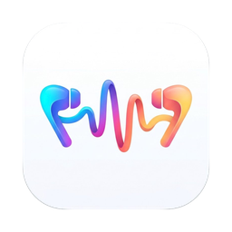
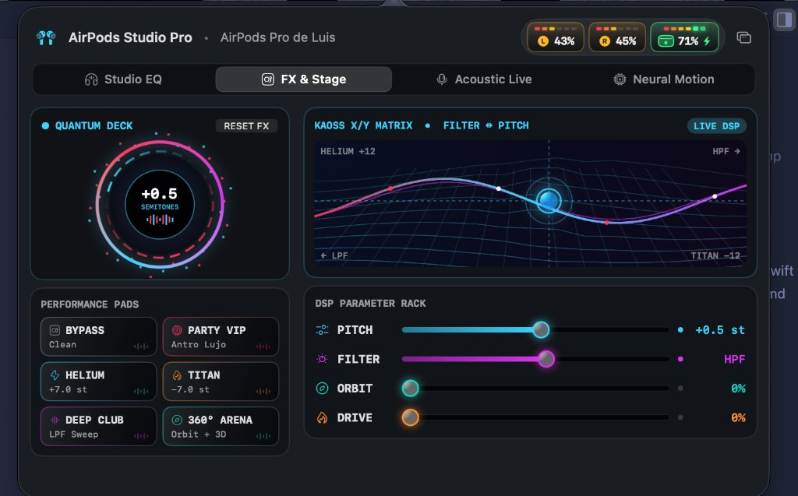
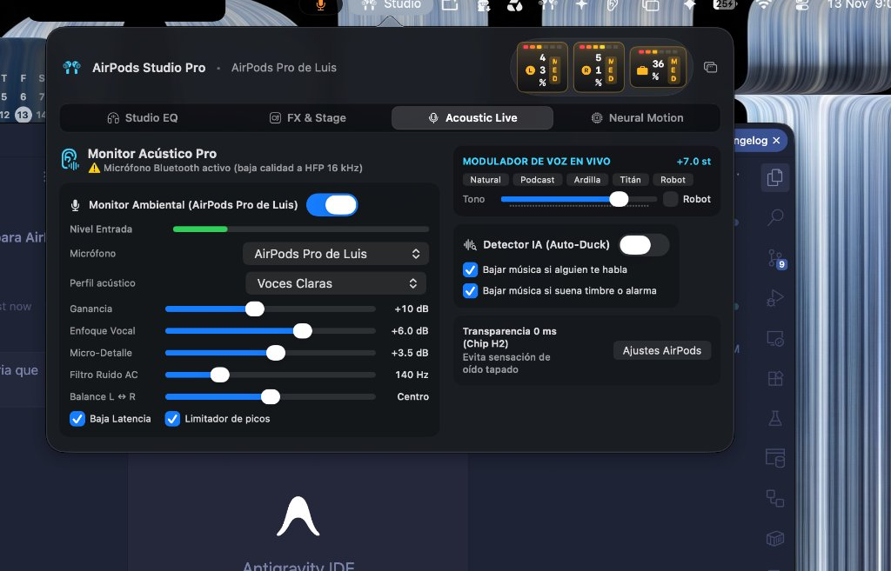
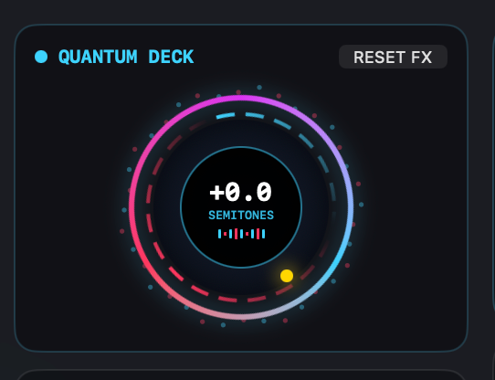
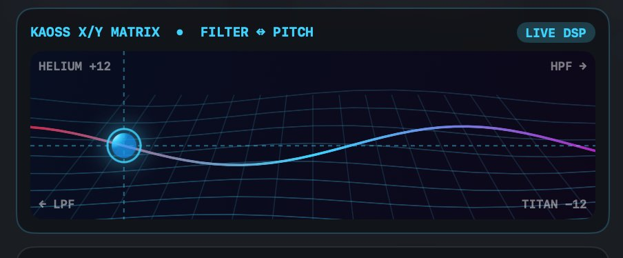

<p align="center">
  
</p>

<h1 align="center">AirPods Studio Pro (<code>AirpodsLuchi</code>)</h1>

<p align="center">
  
</p>

<p align="center">
  
  
  
  
  
</p>

**AirPods Studio Pro** is a native macOS menu-bar and floating-window audio studio built from the ground up in Swift to unlock the full acoustic, spatial, creative, and sensor potential of **AirPods Pro** on Mac.

---

## Why This App Was Created

macOS exposes only basic volume and output switching for AirPods, leaving their real hardware capabilities—head-tracking IMU sensors, low-latency spatial rendering, microphone monitoring, and system-wide sound shaping—underutilized or locked inside individual apps.

**AirPods Studio Pro** was created to bridge that gap in a single zero-bloat native app:
- **System-Wide Precision Audio:** Shape *every* sound coming out of your Mac (Spotify, YouTube, Apple Music, games, browsers) without virtual audio cable headaches.
- **Bit-Exact & Low-Latency DSP:** Smooth per-sample biquad coefficient interpolation, native Bluetooth A2DP frame sizing, and pure passthrough when idle so audio quality never degrades.
- **Playful Live DJ, Radio & Accessibility Tools:** From live `Kaoss X/Y` effects and `Beat Roll` stutters over streaming music, to an `ON AIR` radio announcer booth with `Talkover` and studio-recorded *iCarly*-style crowd & DJ soundboard effects, to a real-time acoustic hearing-assist monitor with AI sound ducking.

---

## Built Specifically for AirPods Hardware

Unlike generic Mac equalizers, **AirPods Studio Pro** is engineered around the physical sensors, Bluetooth audio profile, and acoustic characteristics of **AirPods Pro**:

- **6-DoF Head-Tracking Spatial Audio (`CMHeadphoneMotionManager`):** Reads live quaternion/yaw head orientation from the AirPods IMU and computes real-time **Interaural Time Difference (ITD)**, **Interaural Level Difference (ILD)**, and **Head-Shadow Low-Pass Filtering** so the soundstage stays anchored in space as you turn your head.
- **AirPods Pro Live Battery & Case Telemetry:** Queries `SPBluetoothDataType` via `system_profiler` to display individual **Left (`L`)**, **Right (`R`)**, and **Charging Case** percentages with a custom breathing-LED AirPods case vector glyph, 6-segment color-coded bars, and active charging wave animation.
- **Bluetooth A2DP vs. HFP Guard:** Actively monitors the active macOS input device and warns when a Bluetooth microphone forces AirPods down from high-fidelity **48 kHz A2DP stereo** into **16 kHz HFP call mode**, preserving studio audio quality.
- **Jaw-Clench & Head-Gesture Controls:** Uses AirPods accelerometer peaks and head pitch/yaw motion for hands-free scrolling, screen capture triggers, and posture alerts.

---

## Core Modules (5 Studio Tabs)

### 1. Studio EQ & Binaural 3D Stage
- **10-Band Parametric/Shelf System EQ** (`32 Hz` to `16 kHz`) powered by **Core Audio Process Taps** (`AudioHardwareCreateProcessTap`), with both **Pro Curve (`LOW / MID / HIGH`)** and **10-Band Precision** interactive spectrum canvas at 60 fps.
- **Click-Free Transitions:** Per-sample coefficient ramping (`~25 ms`) and dry/wet crossfade eliminate pops when toggling EQ or switching presets.
- **Built-in Sound Profiles:** *Plano*, *Bass Boost*, *Vocal / Podcast*, *Gaming*, *Cine*, *Party VIP (Antro de Lujo)*, *Microbús (Sonidero)*, and *Auto de Lujo (Hi-Fi)*.
- **Binaural 3D Spatial Audio + Head Tracking:** Mid/Side stereo widening with mono bass anchor (`< 140 Hz`), tight binaural micro-reflections, and real-time **ITD + ILD + Head-Shadow LPF** driven by `CMHeadphoneMotionManager`.

### 2. FX & Stage (Live DJ Console)
- **Live Media Transport Bar:** Control `Previous`, `Play/Pause`, `Next`, and system volume for Spotify, Apple Music, or YouTube directly from the studio.
- **Real-Time Performance Tools:** Instant **Bass Kill (`< 195 Hz`)**, **CDJ Beat Roll / Stutter (`1/8`, `1/16`)**, **Drop FX** auto build-up, and **Space Echo** ping-pong stereo delay.
- **Quantum Deck:** 60 fps vector holographic platter with 36-bar radial harmonic visualizer and orbital comet trail.
- **Kaoss X/Y Matrix:** 2D vector wave-grid pad controlling `Filter (LPF ↔ HPF)` and `Pitch (-12 ↔ +12 st)` simultaneously.
- **Performance Pads:** One-click scenes (*Bypass*, *Party VIP*, *Microbús*, *Auto Lujo*, *Helium*, *Titan*, *Deep Club*, *360° Arena*).

### 3. Radio Live (Broadcast & Announcer Booth)
- **ON AIR Broadcast Header:** One-click `INICIAR EMISIÓN` with live `MM:SS` broadcast timer and pulsing `ON AIR` badge.
- **Talkover (Auto-Duck Music Bed):** Smoothly attenuates background music before mixing microphone voice and soundboard effects so the announcer cuts cleanly through any track.
- **Announcer Voice Console:** Mic selector, live VU meter, quick voice presets (*Radio FM*, *Podcast*, *Sonidero*, *Anónimo*), gain, pitch, cabin echo, and robot mode.
- **Real-Time Studio Soundboard (`Show / iCarly` & `Cabina DJ`):** Zero-latency stereo WAV playback (`48 kHz / 16-bit PCM` preloaded into memory) + synthesized DJ jingles mixed straight into the master limiter:
  - *Show / iCarly Bank:* **Aplausos**, **Risas**, **Aww / Llanto**, **Abucheo**, **Ba-Dum-Tss**, **Grillos**, **Crossover (Público Loco)**, and **Entrada Épica**.
  - *Cabina DJ Bank:* **Airhorn**, **Ding Cabina**, **Laser FX**, **Sub Drop**, **Sirena DJ**, and **Vinyl Scratch**.

### 4. Acoustic Live (Hearing Assist & Live Voice Modulator)
- **Low-Latency Environmental Monitor:** Captures built-in Mac or external microphones via Core Audio HAL `AudioUnit` / `AudioDeviceIOProc` and routes them cleanly through `MicBridge` into the master output.
- **Acoustic Profiles:** *Natural*, *Voces Claras*, *Susurros / Nocturno*, *Enfoque TV*, with AC rumble high-pass filter, vocal focus, micro-detail, L/R balance, and peak safety limiter.
- **AI Sound Awareness (`SoundAnalysis`):** Automatically ducks music when speech, doorbells, or alarms are detected nearby.
- **HFP Guard:** Warns when a Bluetooth mic is selected (which switches AirPods to 16 kHz HFP call mode).

### 5. Neural Motion & Live Battery Telemetry
- **AirPods IMU Gestures:** Head-scroll, jaw-clench detection, posture alerts, and optional camera eye-tracking (`AVFoundation` + `Vision`).
- **Color-Coded Battery Pill (`L`, `R`, `Case`):** Custom animated AirPods Pro charging case glyph with breathing LED, 6-segment multicolor level bars (**Low `0–25%`**, **Medium `26–64%`**, **High `65–100%`**), and animated charging wave + bolt indicator.

---

## Screenshots

<table>
  <tr>
    <td align="center"><b>FX &amp; Stage (Live DJ &amp; Kaoss Matrix)</b><br/></td>
    <td align="center"><b>Acoustic Live &amp; Voice Modulator</b><br/></td>
  </tr>
  <tr>
    <td align="center"><b>Quantum Deck (60 fps Vector Platter)</b><br/></td>
    <td align="center"><b>Kaoss X/Y Matrix (Vector Wave Mesh)</b><br/></td>
  </tr>
</table>

---

## Technology Stack & Architecture

### Real-Time Audio & Sensor Signal Flow

```text
  macOS System Audio (Spotify / YouTube / Music / Games)
        │
        ▼  [Core Audio Process Tap: AudioHardwareCreateProcessTap]
  ┌─────────────────────────────────────────────────────────────────────┐
  │ EQDSP (Lock-Minimized Real-Time Render Callback, 48 kHz Stereo)    │
  │  1. 10-Band Biquad IIR EQ (25 ms per-sample coefficient ramp)       │
  │  2. DJ FX Rack: Bass Kill · Beat Roll Stutter · Pitch Shift ·       │
  │     LPF/HPF Sweep · Drive · Ping-Pong Space Echo                    │
  │  3. Binaural 3D Stage: M/S Widener + ITD/ILD/Head-Shadow (← Yaw)    │
  │  4. Radio Talkover Music-Bed Gain + MicBridge Voice + WAV Soundboard│
  │  5. Look-Free Peak Limiter (0.97 ceiling) → AirPods A2DP Output    │
  └─────────────────────────────────────────────────────────────────────┘
        ▲                                      ▲
        │ CMHeadphoneMotionManager (IMU)       │ AVAudioEngine / HAL + SoundAnalysis
  AirPods Pro Head Tracking             Mac Mic + AI Ducking + Voice Modulator
```

| Layer | Technologies Used | Purpose |
| :--- | :--- | :--- |
| **Language & Concurrency** | Swift 6, Swift Concurrency, `os_unfair_lock`, `UnsafeMutablePointer` buffers | Zero-allocation, lock-minimized real-time audio render thread |
| **UI & 60 fps Graphics** | SwiftUI, AppKit (`NSPopover`, `NSWindow`), `Canvas`, `TimelineView` | Interactive spectrum analyzer, Kaoss X/Y wave mesh, Quantum Deck platter, and floating studio |
| **System Audio Capture** | Core Audio (`AudioHardwareCreateProcessTap`, `AudioObject`, Aggregate Devices) | System-wide audio interception and routing without third-party virtual audio drivers |
| **Real-Time DSP** | Cascaded Direct-Form II Biquad IIRs, Overlap-Add Pitch Shifter, Ring-Buffer Delay/Stutter, Binaural ITD/ILD, Soft Peak Limiter | Click-free EQ, 3D head-tracked spatial stage, DJ FX, and preloaded `48 kHz` stereo WAV soundboard mixing |
| **Mic & AI Classification** | `AVFoundation`, Core Audio HAL, `SoundAnalysis` (`SNAudioStreamAnalyzer`) | Low-latency environmental monitoring, live voice pitch/robot modulation, and AI speech/alarm auto-ducking |
| **AirPods Motion & Vision** | `CoreMotion` (`CMHeadphoneMotionManager`), `Vision`, `CGEvent` | 6-DoF AirPods head tracking, jaw-clench & head-gesture triggers, camera gaze tracking, and media transport keys |
| **Hardware Telemetry** | `system_profiler` (`SPBluetoothDataType`), `IOKit` | Live Left / Right / Charging Case battery percentages, charging state, and Bluetooth HFP quality guard |

### Repository Layout

```text
Sources/airpods/
├── main.swift          # App lifecycle, CMHeadphoneMotionManager streamer, launch modes
├── hub.swift           # SwiftUI Studio UI (5 tabs, Quantum Deck, Kaoss Matrix, Radio Live, Battery)
├── audio.swift         # Core Audio Process Tap engine, EQDSP, Spatial 3D, DJ FX, WAV Soundboard
├── spectrum.swift      # 60 fps interactive EQ curve & mirrored spectrum analyzer
├── superear.swift      # Acoustic Live monitor, SoundAnalysis auto-ducking, VoiceModulatorDSP
├── pointer.swift       # Head/gaze pointer & gesture interaction
├── gaze.swift          # Camera gaze feature extraction
├── reicon.swift        # Custom vector icon system
├── Info.plist          # App bundle metadata & macOS privacy usage descriptions
└── Resources/SFX/      # Preloaded 48 kHz 16-bit stereo WAV clips for Radio Live Soundboard
build.sh                # Compiles swiftc release binary, bundles Resources, signs airpods.app
```

---

## Build & Run

### Requirements
- **macOS 14.2+** (required for Core Audio Process Taps)
- **Xcode Command Line Tools** (`swiftc`)
- **AirPods Pro** (2nd/3rd gen recommended for head tracking & battery telemetry)

### Build

```bash
git clone https://github.com/LuisandovalU/AirpodsLuchi.git
cd AirpodsLuchi
./build.sh
open airpods.app
```

### Recommended macOS Permissions
- **Audio Capture / Microphone:** Needed for *Studio EQ* system tap and *Acoustic Live / Radio Live* mic routing.
- **Motion & Fitness:** Needed for AirPods head-tracking in *3D Spatial Audio* and *Neural Motion*.
- **Accessibility:** Needed for media transport keys (`Play/Pause`, `Next`, `Prev`) and gesture shortcuts.

---

## License

Built with passion for macOS audio engineering and AirPods Pro experimentation.
